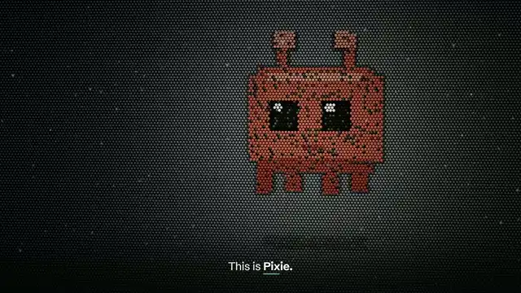

# Show Its Work

<a href="https://youtu.be/AAQG61EsGcM"></a>

A 49-minute film about all 66 of my public repositories. A wall of steel pins plays every scene, Pixie from [Claude Code, in motion](https://github.com/AnwarDebes/Claude-Code-In-Motion) is the guide, and every word of the narration is on screen as it is spoken. Every number carries a chip with the repository, file and line it came from, and the last chapter checks the film's own sources.

**[▶ Watch it on YouTube (49:27)](https://youtu.be/AAQG61EsGcM)** · [Download it in 1080p60](https://github.com/AnwarDebes/anwar-debes-film/releases/latest)

A short film about each repository: [YouTube](https://www.youtube.com/@anwardebes) · [TikTok](https://www.tiktok.com/@anwardebes)

## Chapters

|  | Chapter | Starts | Repositories |
|---|---|---|---|
| 01 | True or false | 0:00 | [AnwarDebes.github.io](https://github.com/AnwarDebes/AnwarDebes.github.io), [AnwarDebes](https://github.com/AnwarDebes/AnwarDebes), [Assignment1Cloud](https://github.com/AnwarDebes/Assignment1Cloud), [WebOfEverything-](https://github.com/AnwarDebes/WebOfEverything-), [PROG2053](https://github.com/AnwarDebes/PROG2053), [HexGTM](https://github.com/AnwarDebes/HexGTM), [Dynamic_Visualization](https://github.com/AnwarDebes/Dynamic_Visualization), [DNN](https://github.com/AnwarDebes/DNN), [Deep-Neural-Networks-Assignments](https://github.com/AnwarDebes/Deep-Neural-Networks-Assignments) |
| 02 | Before the runs | 3:32 | [glassbox-lm](https://github.com/AnwarDebes/glassbox-lm) |
| 03 | The session wasn't | 6:27 | [trace](https://github.com/AnwarDebes/trace) |
| 04 | Prove it | 9:13 | [veritas](https://github.com/AnwarDebes/veritas) |
| 05 | The forward pass | 12:02 | [candor](https://github.com/AnwarDebes/candor) |
| 06 | After the alarm | 14:48 | [reins](https://github.com/AnwarDebes/reins), [THGTM](https://github.com/AnwarDebes/THGTM), [clausegate](https://github.com/AnwarDebes/clausegate), [Clause-Driven-LLM](https://github.com/AnwarDebes/Clause-Driven-LLM), [clause86](https://github.com/AnwarDebes/clause86), [clauseguard](https://github.com/AnwarDebes/clauseguard) |
| 07 | Every step | 19:40 | [Claude-Code-In-Motion](https://github.com/AnwarDebes/Claude-Code-In-Motion), [vsclaude](https://github.com/AnwarDebes/vsclaude) |
| 08 | The rules | 23:05 | [lucid](https://github.com/AnwarDebes/lucid), [RL](https://github.com/AnwarDebes/RL), [RL-CCA](https://github.com/AnwarDebes/RL-CCA) |
| 09 | Graphs a clause can walk | 26:35 | [tsetlin-zoo](https://github.com/AnwarDebes/tsetlin-zoo), [subword-dep-graphtm](https://github.com/AnwarDebes/subword-dep-graphtm), [attention-distilled-graphtm](https://github.com/AnwarDebes/attention-distilled-graphtm), [decoder-attention-distill-graphtm](https://github.com/AnwarDebes/decoder-attention-distill-graphtm), [tm-llm-robustness-benchmark](https://github.com/AnwarDebes/tm-llm-robustness-benchmark), [HGTM](https://github.com/AnwarDebes/HGTM), [RGTM](https://github.com/AnwarDebes/RGTM), [Multi-HGTM](https://github.com/AnwarDebes/Multi-HGTM), [graphtm-cbr](https://github.com/AnwarDebes/graphtm-cbr) |
| 10 | Built for people | 32:23 | [PocketOS](https://github.com/AnwarDebes/PocketOS), [Mneme-Education-Ecosystem](https://github.com/AnwarDebes/Mneme-Education-Ecosystem), [IDM](https://github.com/AnwarDebes/IDM), [drone-id](https://github.com/AnwarDebes/drone-id), [SkillBridgeNorway](https://github.com/AnwarDebes/SkillBridgeNorway), [CYFS](https://github.com/AnwarDebes/CYFS), [Kaleido](https://github.com/AnwarDebes/Kaleido), [cookie-galaxy](https://github.com/AnwarDebes/cookie-galaxy) |
| 11 | Promises | 36:26 | [DiTM](https://github.com/AnwarDebes/DiTM), [ConfTM](https://github.com/AnwarDebes/ConfTM), [RobTM](https://github.com/AnwarDebes/RobTM), [CCTM](https://github.com/AnwarDebes/CCTM), [FedTM](https://github.com/AnwarDebes/FedTM), [lifelong-tm](https://github.com/AnwarDebes/lifelong-tm) |
| 12 | Models of the everyday | 39:19 | [SleepArchitect](https://github.com/AnwarDebes/SleepArchitect), [CaffeineSense](https://github.com/AnwarDebes/CaffeineSense), [HotCarWatch](https://github.com/AnwarDebes/HotCarWatch), [SmokeShield](https://github.com/AnwarDebes/SmokeShield), [PipeGuard](https://github.com/AnwarDebes/PipeGuard), [HomeJoule](https://github.com/AnwarDebes/HomeJoule), [PyroPredict](https://github.com/AnwarDebes/PyroPredict), [ThermoGuard](https://github.com/AnwarDebes/ThermoGuard) |
| 13 | Real stakes | 43:16 | [knotten-web](https://github.com/AnwarDebes/knotten-web), [knotten-test](https://github.com/AnwarDebes/knotten-test), [knotten-test-2](https://github.com/AnwarDebes/knotten-test-2), [grimstad-kiosk-grill](https://github.com/AnwarDebes/grimstad-kiosk-grill), [Trondheim-Cookies](https://github.com/AnwarDebes/Trondheim-Cookies), [ballast](https://github.com/AnwarDebes/ballast), [hugin](https://github.com/AnwarDebes/hugin), [Goblin](https://github.com/AnwarDebes/Goblin) |
| 14 | Show its work | 46:44 | [video-editing-skill](https://github.com/AnwarDebes/video-editing-skill), [ai-medical-training-simulator](https://github.com/AnwarDebes/ai-medical-training-simulator), [assets](https://github.com/AnwarDebes/assets) |

## The film checks its own sources

Every source on screen is an entry in [`film-ledger.json`](film-ledger.json), in the order it appears: 541 entries, each hashed and chained to the one before.

| Type | Entries | What is hashed |
|---|---:|---|
| file@commit | 505 | the cited file at its pinned commit |
| capture | 26 | a screen recording or terminal capture in this repository |
| commit | 5 | the commit itself |
| api-snapshot | 5 | a saved GitHub API response |

Check it yourself:

```bash
git clone https://github.com/AnwarDebes/anwar-debes-film
cd anwar-debes-film
node verify-ledger.mjs
```

It clones every cited repository fresh from GitHub, re-hashes each source, recomputes the chain and prints the head hash, `6578f88114dce6bc539e7ac36218a454391981e8bdb6d1064d3382f201481dc2`. Chapter 14 plays a recorded run of exactly this. The chain is hash-linked, not signed: anyone can recompute it.

## How it is made

- **Every frame is code.** React, Three.js and Remotion: 14 chapters, 127 scenes and 178,044 frames at 60 fps, rendered with WebGL on the GPU in headless Chrome and encoded with NVENC.
- **One synthetic voice, generated locally.** 346 narration lines, synthesized on a GPU and aligned word by word, so each word lands on screen as it is spoken.
- **Sound.** Original synthesis, CC0 sounds and Scott Buckley's score, mixed under the voice and mastered to −15 LUFS.
- **Sources first.** The ledger is collected from the film itself: a low-resolution render logs every chip it draws (`scripts/ledger`).

## Run it

```bash
npm ci
npm run studio                       # every chapter in Remotion Studio
node scripts/audio/fetch-music.mjs   # the licensed score, which is not committed
```

The chapter beds in `public/chNN/music/` come from the URL in the JSON next to each. `scripts/render-film.mjs` renders the chapters in parts, joins them and muxes the mix.

## Credits

- **Music:** 'Decoherence', 'Resonance', 'Tears in Rain', 'Nightfall', 'Machina', 'Discovery', 'Filaments', 'Aphelion', 'Catalyst' and 'Stars In Her Skies' by Scott Buckley – released under CC-BY 4.0. [www.scottbuckley.com.au](https://www.scottbuckley.com.au). Edited for length and mixed under narration.
- **Sound design:** original synthesis · BigSoundBank · Kenney (CC0)
- **Fonts:** JetBrains Mono, STIX Two and Schibsted Grotesk, under the SIL Open Font License (`public/fonts`)
- **Pixie:** [Claude-Code-In-Motion/web/js/mascot.js](https://github.com/AnwarDebes/Claude-Code-In-Motion/blob/main/web/js/mascot.js) (MIT)
- **Narration:** one synthetic voice, generated locally

The film and its code are © 2026 Anwar Debes. The music, fonts and Pixie keep the licenses above.
